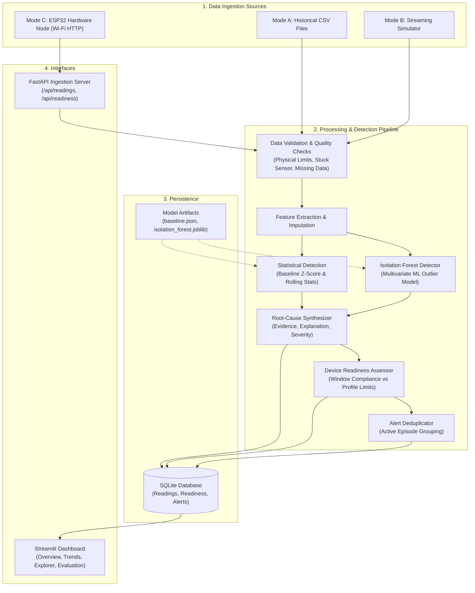

# EDAS-IoT: Environmental Anomaly Detection and IoT Deployment Readiness System

[](https://www.python.org/)
[](https://fastapi.tiangolo.com/)
[](https://streamlit.io/)
[](https://scikit-learn.org/)
[](LICENSE)

An end-to-end environmental assessment platform that monitors ambient conditions (temperature, relative humidity, atmospheric pressure), establishes a baseline of normal behavior, detects univariate and multivariate anomalies, and evaluates whether a site is suitable for deploying specified IoT devices.

---

## Key Capabilities

- **Three Ingestion Modes:**
  - **Mode A (CSV Mode):** Ingest historical sensor records from CSV files for offline batch detection.
  - **Mode B (Simulated Streaming Mode):** Real-time observation-by-observation playback with live on-the-fly anomaly injection.
  - **Mode C (ESP32 Hardware Mode):** HTTP POST telemetry ingestion from physical ESP32 nodes equipped with BME280 or DHT22 sensors.
- **Data Quality & Physical Validation:** Explicitly flags malformed payloads, out-of-order timestamps, duplicates, missing metrics, and stuck/frozen sensors without corrupting raw data.
- **Dual-Layer Anomaly Detection:**
  - **Interpretable Statistical Layer:** Baseline Z-score against calibrated normal conditions and short-term rolling window statistics.
  - **Machine Learning Layer:** Unsupervised Scikit-Learn **Isolation Forest** trained on normal data to catch rare multivariate perturbations that individual thresholding misses.
- **Rule-Based IoT Deployment Readiness Assessment:** Evaluates whether ambient observations within a sliding time window satisfy manufacturer operating limits and safety margins for a target device profile (e.g. `Standard_Indoor_Gateway`, `Cold_Storage_Tracker`, `Outdoor_Rugged_Sensor`).
- **Event Deduplication & Alert Severity:** Automatically groups continuous episodes into deduplicated alert events (`INFO`, `WARNING`, `CRITICAL`, `DATA_QUALITY`).
- **Interactive Streamlit & Plotly Dashboard:** Provides real-time trend plots, anomaly inspection tables, readiness cards, confusion matrix heatmaps, and simulation controls.

---

## System Architecture



---

## Project Structure

```text
EDAS-IoT/
├── config/
│   ├── settings.yaml            # Physical limits, detection thresholds, DB path
│   └── device_profiles.yaml     # IoT device hardware profiles & safety margins
├── data/
│   ├── raw/                     # Raw incoming uploads
│   ├── processed/               # Evaluation reports & processed records
│   └── samples/                 # Sample datasets (baseline_normal.csv, evaluation_labeled.csv)
├── models/
│   ├── baseline.json            # Calibrated baseline statistics
│   └── isolation_forest.joblib  # Trained scikit-learn model artifact
├── scripts/
│   ├── generate_data.py         # Synthetic dataset generator with 10 anomaly types
│   ├── train_model.py           # Baseline calibration & Isolation Forest training
│   └── evaluate_model.py        # Benchmark evaluation script (Precision, Recall, F1)
├── src/
│   ├── common/                  # Pydantic schemas and config loader
│   ├── ingestion/               # CSVReader, SensorSimulator, and FastAPI app
│   ├── processing/              # DataValidator, FeatureEngineer, EDASPipeline
│   ├── detection/               # BaselineCalibrator, StatisticalAnomalyDetector, IsolationForestDetector
│   ├── assessment/              # ReadinessAssessor, AnomalyExplainer, AlertManager
│   └── storage/                 # DatabaseRepository (SQLite)
├── dashboard/
│   └── app.py                   # Streamlit multi-page dashboard
├── firmware/
│   └── esp32_environment_monitor/
│       └── esp32_environment_monitor.ino  # ESP32 C++ firmware with backoff retries
├── tests/                       # Automated pytest suite (20 tests)
├── requirements.txt             # Python dependencies
├── .env.example                 # Environment configuration template
└── README.md
```

---

## Quickstart Guide

### 1. Prerequisites
- Python 3.10+ (Tested on Python 3.13)
- Optional: ESP32 development board with BME280 or DHT22 sensor

### 2. Environment Setup

#### Windows (PowerShell):
```powershell
# Clone or navigate to the repository directory
cd "c:\Users\91906\OneDrive\Documents\Self Projects\EDAS-IoT"

# Create and activate virtual environment
python -m venv .venv
.\.venv\Scripts\Activate.ps1

# Install dependencies
pip install -r requirements.txt
```

#### macOS / Linux:
```bash
python3 -m venv .venv
source .venv/bin/activate
pip install -r requirements.txt
```

### 3. Generate Sample Data & Train Model
```powershell
# 1. Generate realistic 24-hour baseline & evaluation datasets
python scripts/generate_data.py

# 2. Calibrate baseline and fit Isolation Forest
python scripts/train_model.py

# 3. Evaluate model performance on controlled anomalies
python scripts/evaluate_model.py
```

### 4. Run the Streamlit Dashboard
```powershell
streamlit run dashboard/app.py
```
Open [http://localhost:8501](http://localhost:8501) in your browser to view the interactive dashboard.

### 5. Run the Ingestion API (For Hardware Mode C or External Clients)
```powershell
uvicorn src.ingestion.api:app --host 0.0.0.0 --port 8000 --reload
```
Interactive Swagger API documentation will be available at [http://127.0.0.1:8000/docs](http://127.0.0.1:8000/docs).

---

## Benchmark Evaluation Performance

Evaluated on `evaluation_labeled.csv` (1,440 continuous observations across a full 24-hour diurnal cycle with 10 controlled anomaly types):

| Metric | Overall Pipeline (Validation + Stat + ML) | Isolation Forest ML Alone | Statistical Detector Alone |
|---|---|---|---|
| **Precision** | **93.94%** | 89.66% | 100.0% |
| **Recall** | **89.42%** | 50.00% | 68.27% |
| **F1-Score** | **0.9163** | 0.6420 | 0.8114 |
| **False Positive Rate (FPR)** | **0.45%** (6 / 1,336) | 0.45% | 0.00% |

### Anomaly-Type Detection Rates:
- `HUMIDITY_OUT_OF_RANGE`: **100.0%** (27/27)
- `INVALID_MEASUREMENT`: **100.0%** (4/4)
- `MISSING_DATA`: **100.0%** (5/5)
- `MULTIVARIATE_ANOMALY`: **100.0%** (10/10)
- `PRESSURE_SPIKE`: **100.0%** (8/8)
- `TEMPERATURE_SPIKE`: **100.0%** (8/8)
- `TEMPERATURE_DROP`: **100.0%** (7/7)
- `TEMPERATURE_DRIFT`: **84.0%** (21/25)
- `STUCK_SENSOR`: **70.0%** (7/10) _(Flags immediately once consecutive unchanged window is satisfied)_

---

## Hardware Setup (ESP32 Integration)

### Wiring Pinout

#### BME280 (I2C):
| ESP32 Pin | BME280 Pin | Description |
|---|---|---|
| 3V3 | VCC / VIN | 3.3V Power |
| GND | GND | Ground |
| GPIO 21 | SDA | I2C Data |
| GPIO 22 | SCL | I2C Clock |

#### DHT22 (Single-Bus):
| ESP32 Pin | DHT22 Pin | Description |
|---|---|---|
| 3V3 | VCC (Pin 1) | 3.3V Power |
| GPIO 4 | DATA (Pin 2) | Data line (10k pull-up to 3.3V) |
| GND | GND (Pin 4) | Ground |

### Flashing the Firmware
1. Open `firmware/esp32_environment_monitor/esp32_environment_monitor.ino` in Arduino IDE.
2. Install required Arduino libraries: `Adafruit BME280 Library`, `DHT sensor library`, `ArduinoJson`.
3. Update `WIFI_SSID`, `WIFI_PASSWORD`, and `SERVER_URL` with your local network IP (e.g. `http://192.168.1.100:8000/api/readings`).
4. Select board **ESP32 Dev Module** and upload.

---

## Configuration

### `config/settings.yaml`
```yaml
physical_limits:
  temperature_c: {min: -40.0, max: 85.0}
  humidity_pct: {min: 0.0, max: 100.0}
  pressure_hpa: {min: 300.0, max: 1100.0}

detection:
  statistical:
    z_score_threshold: 3.0
    rolling_window_size: 10
    rolling_z_threshold: 2.5
    min_history_for_rolling: 5
    stuck_sensor_window: 5
```

### `config/device_profiles.yaml`
Custom device limits can be defined in YAML:
```yaml
Standard_Indoor_Gateway:
  min_temperature_c: 5.0
  max_temperature_c: 40.0
  min_humidity_pct: 10.0
  max_humidity_pct: 75.0
  required_parameters: ["temperature_c", "humidity_pct"]
  safety_margins: {temperature_c: 3.0, humidity_pct: 5.0}
```

---

## Running Automated Tests

Run the test suite using `pytest`:
```powershell
python -m pytest tests/ -v
```
All 20 test cases covering validation, statistical division safeguards, Isolation Forest inference, device readiness logic, and API endpoints are verified automatically.

---

## Important Limitations

1. **Short Observation Windows:** A short evaluation period (e.g. hours or days) cannot guarantee multi-year environmental suitability. Seasonal weather extremes, solar exposure variations, and rare storm events must be accounted for.
2. **Statistical Unusualness vs Danger:** The Isolation Forest identifies statistically rare combinations relative to the baseline training dataset. Statistical unusualness does not necessarily imply physical hazard or hardware damage.
3. **Enclosure & Microclimate:** External sensor readings reflect the ambient atmosphere. The internal temperature and humidity inside a sealed IoT enclosure may differ significantly due to internal heat dissipation, solar loading, and ventilation.
4. **Assessment Confidence:** When fewer than the minimum required samples are available or sensor quality issues occur, the system returns `INSUFFICIENT_DATA` or `SENSOR_DATA_INVALID` rather than falsely asserting deployment readiness.

---

## License
This project is licensed under the MIT License.
